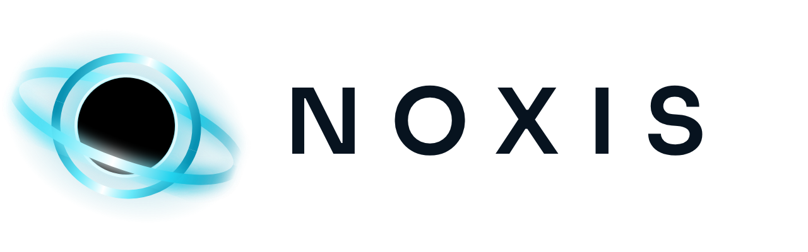
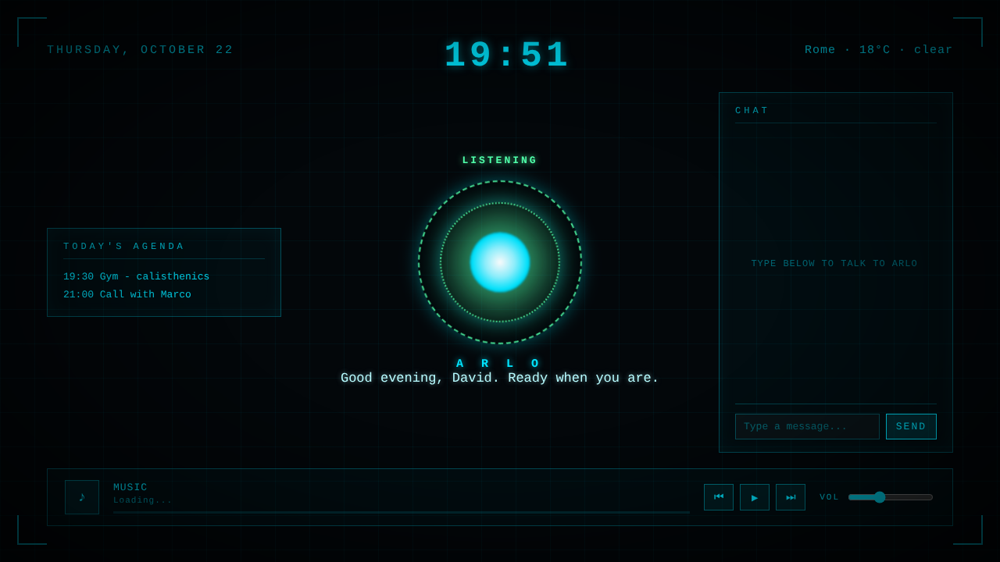
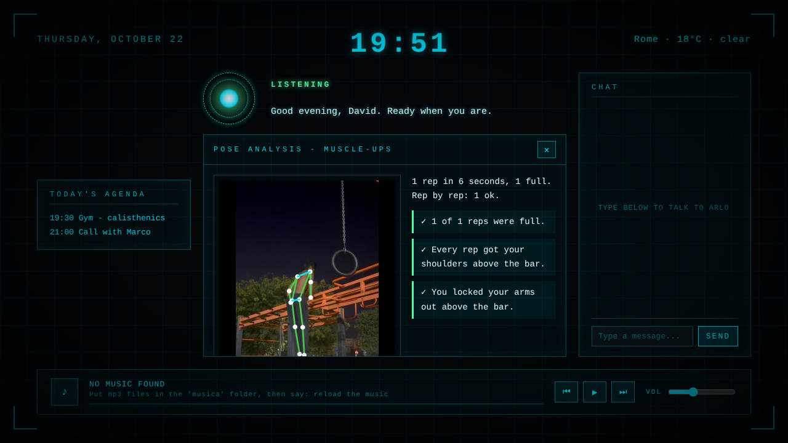
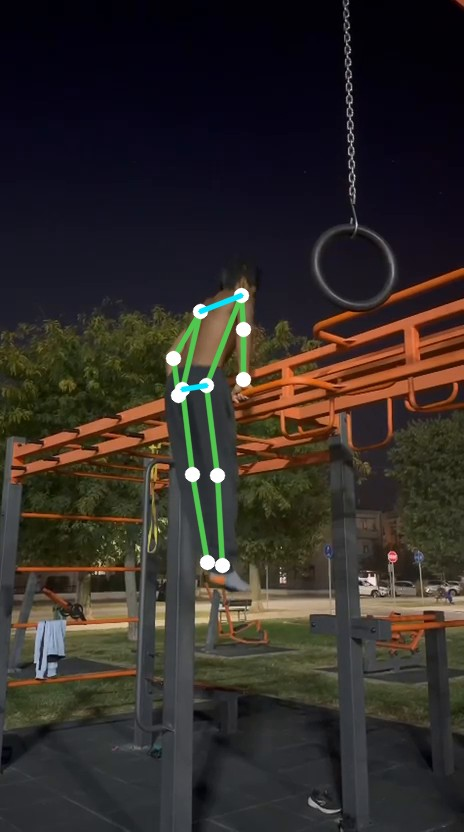
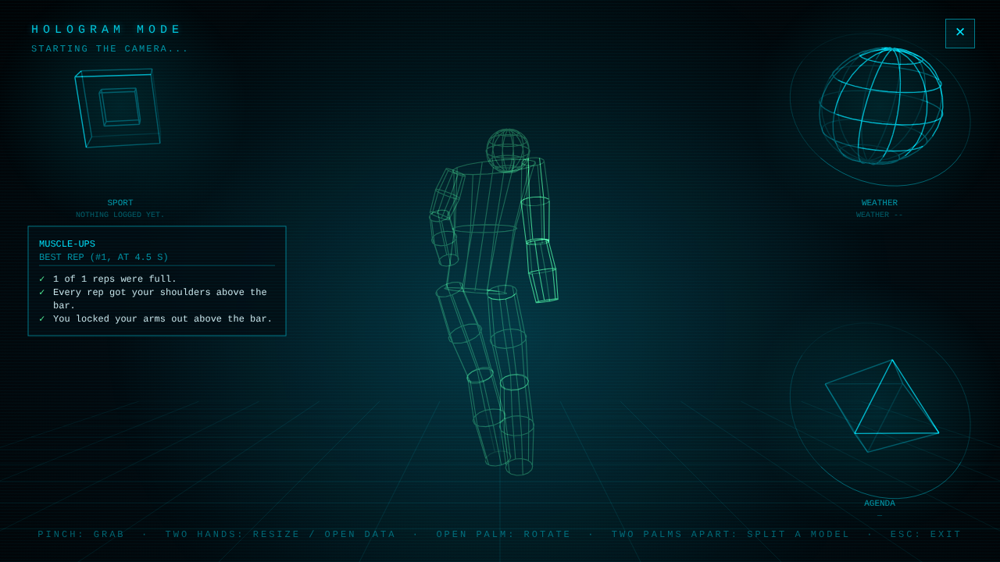
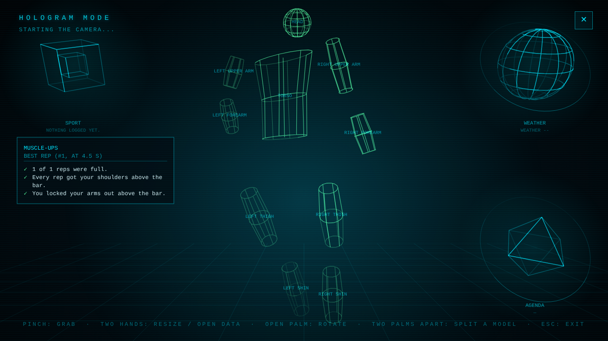
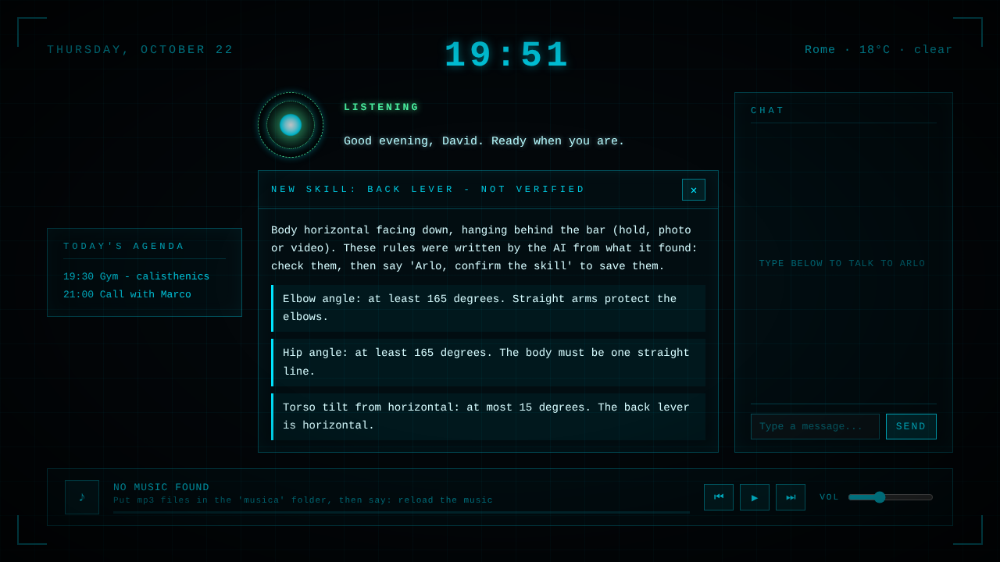

<picture>
  <source media="(prefers-color-scheme: dark)" srcset="media/noxis-logo-orizzontale-scuro.png">
  
</picture>

**A personal AI assistant, built at home in Python.**
Voice control, a holographic 3D interface you drive with your hands, and a calisthenics coach that watches your form.

*Still in development · source code is private for now · this page shows what it can do*

---

## What is Noxis?

Noxis is my own "Jarvis-style" desktop assistant. I've been building it for about six months.
It lives in a small HUD on the screen, it's always listening, and you wake it up by saying **"Noxis"** or by **clapping twice**.
You can talk to it or type in the chat.

## Everyday features

| | |
|---|---|
| 📅 **Agenda** | Reads and adds events in Google Calendar |
| ✉️ **Email** | Reads your Gmail |
| 📁 **Drive** | Finds your files on Google Drive |
| 🎵 **Music** | Plays your playlist, with controls in the HUD |
| ⛅ **Weather** | Always on screen |
| ⏰ **Reminders** | "Noxis, remind me to..." |
| 📱 **Telegram** | Text it (or send voice notes) from anywhere |
| 🖱️ **Uses your PC** | Sorts folders, creates files and 3D models, clicks and types for you. It always asks first, and you can undo |
| 💡 **Explains** | Shows a topic on screen with pictures and captions |
| 📷 **Webcam** | Looks through the camera and describes what it sees |
| 🕘 **History** | Remembers what you asked |

## Calisthenics coach

Give Noxis a photo or a video of a skill and it checks your **whole body**: elbows, body line, hips, torso and left/right symmetry.
Then it tells you what to fix first, out loud and on screen (green = fine, red = to fix).

- **Holds:** front lever, planche, handstand, L-sit, dragon flag. On video it also measures how many seconds you hold a clean position and when it starts to break.
- **Reps (video):** pull-ups, dips, push-ups, muscle-ups, pistol squats. It counts every rep and checks depth and lockout. It also notices when you slow down from fatigue.

The pose analysis runs locally with MediaPipe: no photo or video leaves the PC.

## Hologram mode

Say **"Noxis, hologram mode"** and the screen becomes a 3D space that follows your hands through the webcam.

- 🤏 **Pinch** to grab an object
- 🙌 **Two hands** to zoom in and out
- ✋ **Open palm** to spin it
- 👐 **Pull both palms apart** to explode a model into its parts, then pinch a part and throw it away to delete it

After a pose analysis, **"Noxis, show it in 3D"** puts your own body in the hologram, with the parts to fix in red.
You can also load your own `.glb` 3D models.

| Your body in 3D | Exploded into parts |
|---|---|
|  |  |

## Noxis learns new skills by itself

Say **"Noxis, learn the back lever"**:

1. Noxis looks the skill up online.
2. An AI turns the technique into measurable rules, using only the body measurements Noxis already knows.
3. Noxis shows you the rules, marked **NOT VERIFIED**. They are only used after you say **"Noxis, confirm the skill"**.

## Coming soon

- 🧠 Hybrid AI: a powerful model in the cloud, plus a small model trained for Noxis that runs on your PC when you're offline (or always, if you prefer)
- 🎙️ New voice and speech recognition
- 🏃 Running and swimming
- ❤️ A home-made heart-rate sensor connected to Noxis

## Trailer

*Noxis was called Arlo until October 2026, so some screenshots still show the old name.*

[▶ Watch the trailer](media/noxis-trailer.mp4)

---

Made by **Davide** · Python · MediaPipe · Groq

⭐ Star this repo if you want to follow the project!

